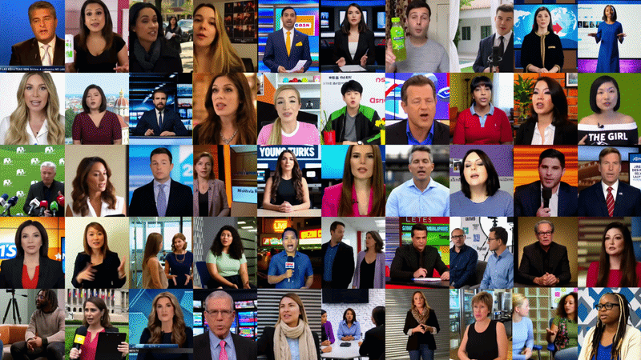
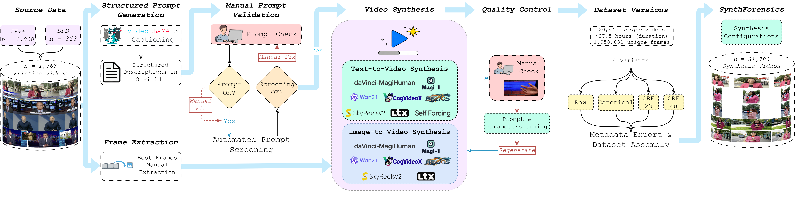
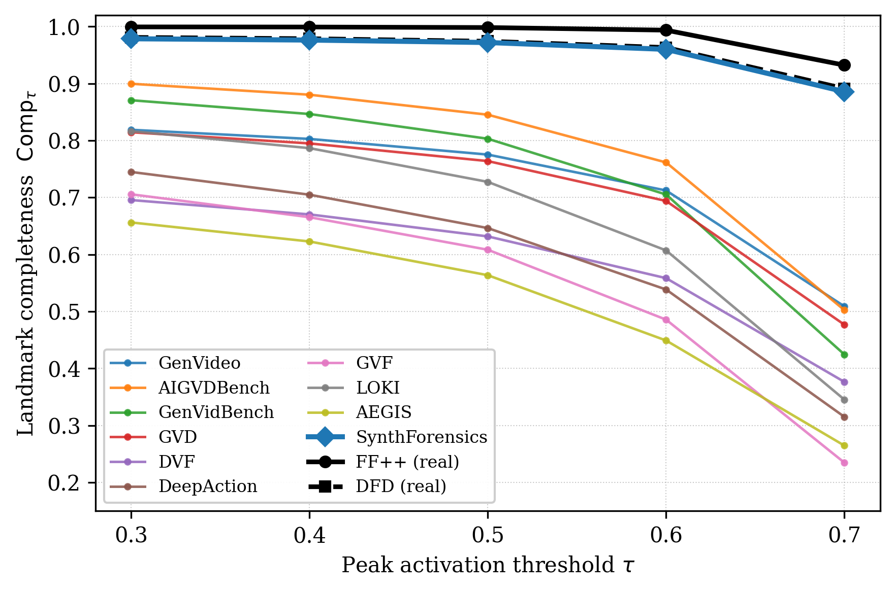
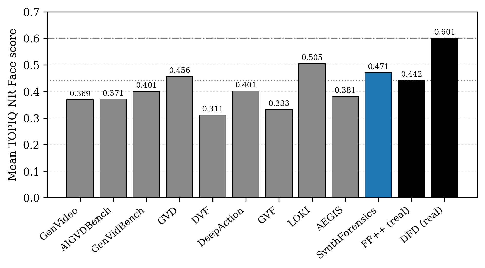
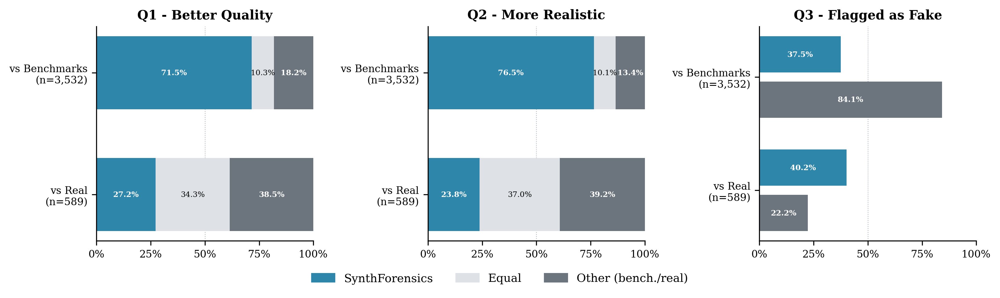

<h1 align="center">SynthForensics: Benchmarking and Evaluating People-Centric Synthetic Video Deepfakes</h1>

<p align="center">
  Roberto Leotta<sup>1,†</sup> · Salvatore Alfio Sambataro<sup>2,†</sup> · Claudio Vittorio Ragaglia<sup>2</sup> · Mirko Casu<sup>2</sup><br>
  Yuri Petralia<sup>1</sup> · Francesco Guarnera<sup>2</sup> · Luca Guarnera<sup>2</sup> · Sebastiano Battiato<sup>2</sup><br>
  <sup>1</sup>iCTLab s.r.l. · <sup>2</sup>University of Catania · <sup>†</sup>Equal contribution
</p>

<p align="center"><strong>NeurIPS 2026, Evaluations &amp; Datasets Track</strong></p>

<p align="center">
  <a href="#"></a>
  <a href="https://arxiv.org/abs/2602.04939"></a>
  <a href="https://rorobertostring.github.io/SynthForensics.github.io/"></a>
  <a href="https://huggingface.co/datasets/SynthForensics/SynthForensics"></a>
  <a href="LICENSE.md"></a>
  <a href="https://creativecommons.org/licenses/by-nc/4.0/"></a>
</p>

<p align="center">
  
</p>

## Abstract

<p align="justify">State-of-the-art open-source T2V/I2V generators synthesize people increasingly hard to distinguish from authentic footage, while current evaluation suites lag: legacy benchmarks target manipulation-based forgeries, and recent synthetic-video benchmarks prioritize scale over realistic human depiction. We introduce SynthForensics, a people-centric benchmark of 20,445 videos from 8 T2V and 7 I2V open-source generators, paired-source from FF++/DFD reals, two-stage human-validated, in four compression versions with full metadata. In our paired-comparison human study, raters prefer SynthForensics in 71–77% of head-to-head comparisons against each of nine existing synthetic-video benchmarks, while facial-quality metrics fall within the FF++/DFD baseline range. Across 15 detectors and three protocols, face-based methods drop 13–55 AUC points (mean 27) from FF++ to SynthForensics and a further 23 under aggressive compression; fine-tuning closes the gap at a backward cost on legacy benchmarks; training from scratch shows synthetic and manipulation features largely disjoint for most detectors. We release dataset, pipeline, and code at the <a href="https://rorobertostring.github.io/SynthForensics.github.io/">project page</a>.</p>

## Updates

- **In progress**: SynthForensics v1.1, which adds videos from two more generators, Wan2.2 and MiniMax H3.
- **Sep 2026**: accepted at the NeurIPS 2026 Evaluations & Datasets Track. The full dataset is on [Hugging Face](https://huggingface.co/datasets/SynthForensics/SynthForensics).
- **May 2026**: extended paper (v2) on [arXiv](https://arxiv.org/abs/2602.04939v2): 20,445 videos from 8 T2V and 7 I2V generators, a human realism study, and 15 detectors.
- **Feb 2026**: first preprint (v1) on [arXiv](https://arxiv.org/abs/2602.04939v1).

## Contents

- [Highlights](#highlights)
- [Construction Pipeline](#construction-pipeline)
- [Dataset](#dataset)
  - [Generators](#generators)
  - [Statistics](#statistics)
  - [Download](#download)
  - [Structure](#structure)
  - [Splits](#splits)
  - [Metadata](#metadata)
  - [Compression Versions](#compression-versions)
- [Repository](#repository)
- [Results](#results)
  - [Comparative Analysis](#comparative-analysis)
  - [Detection](#detection)
- [Responsible Use](#responsible-use)
- [Citation](#citation)
- [Contact](#contact)
- [License](#license)

## Highlights

- **20,445 unique synthetic videos** (~27.5 hours, ~1.96M frames): 10,904 text-to-video (T2V) and 9,541 image-to-video (I2V).
- **8 T2V and 7 I2V open-source generators**, from 1.3B to 24B parameters.
- **Paired-source protocol**: every video is generated from the structured caption of a real FF++ or DFD source video (1,363 sources), and I2V videos also from a reference frame of that video.
- **Two-stage human validation** of both the captions and the generated videos.
- **Four compression versions** of every video (Raw, Canonical, CRF23, CRF40), 81,780 files in total.
- **Full metadata** for every video: prompt (and negative prompt where used), seed, all inference hyperparameters, and model and software versions.
- **11,815 individuals**: 10,904 synthetic identities created by T2V and 911 real people animated by I2V.

## Construction Pipeline

<p align="center">
  
</p>

1. **Source videos**: 1,363 pristine videos from FaceForensics++ (1,000) and the DeepFake Detection dataset (363).
2. **Structured captions**: a vision-language model (VideoLLaMA 3) describes each source video in eight fields (short description, dense description, background, style, shot type, camera movement, lighting, atmosphere).
3. **Caption validation**: field-by-field review by three independent annotators, followed by an LLM screening (Llama 3) across seven sensitive-content categories; flagged captions are rewritten until they pass both checks.
4. **I2V reference frames**: human annotators select, for each source video, a frame with a large, centered, sharp face in a neutral, frontal pose that matches the caption.
5. **Prompt adaptation**: model-specific positive prompts built from the caption fields, and negative prompts curated per generator to suppress recurring artifacts.
6. **Video synthesis**: generation in T2V and I2V mode with each generator's inference settings.
7. **Video validation**: independent inspection by five human annotators, blinded to the source generator, for anatomical, rendering, and temporal artifacts, semantic coherence with the prompt and reference frame, and ethical compliance; rejected videos are regenerated with refined prompts and parameters until accepted.
8. **Compression versions**: every accepted video is released as Raw, Canonical, CRF23, and CRF40.

## Dataset

### Generators

| Generator | Parameters | Modes | Upstream code | Our scripts and settings |
|-----------|-----------:|-------|---------------|--------------------------|
| [Wan2.1](https://github.com/Wan-Video/Wan2.1/tree/9737cba9c1c3c4d04b33fcad41c111989865d315) | 14B | T2V, I2V | `9737cba` | [GENERATION.md](src/generators/Wan2.1/GENERATION.md) |
| [CogVideoX](https://github.com/zai-org/CogVideo/tree/7a1af7154511e0ce4e4be8d62faa8c5e5a3532d2) | 5B | T2V, I2V | `7a1af71` | [GENERATION.md](src/generators/CogVideoX/GENERATION.md) |
| [SkyReels-V2](https://github.com/SkyworkAI/SkyReels-V2/tree/9351d13152207cc04de780e055346b08ade0b851) | 14B | T2V, I2V | `9351d13` | [GENERATION.md](src/generators/SkyReels-V2/GENERATION.md) |
| [Self-Forcing](https://github.com/guandeh17/Self-Forcing/tree/33593df3e81fa3ec10239271dd2c100facac6de1) | 1.3B | T2V | `33593df` | [GENERATION.md](src/generators/Self-Forcing/GENERATION.md) |
| [MAGI-1](https://github.com/SandAI-org/MAGI-1/tree/6ff822e74ded50611e81e1d0e115146b5c4dd2a5) | 24B | T2V, I2V | `6ff822e` | [GENERATION.md](src/generators/MAGI-1/GENERATION.md) |
| [LTX-2.3](https://github.com/Lightricks/LTX-2/tree/9e8a28e17ac4dd9e49695223d50753a1ebda36fe) | 22B | T2V, I2V | `9e8a28e` | [GENERATION.md](src/generators/LTX-2/GENERATION.md) |
| [Helios](https://github.com/PKU-YuanGroup/Helios/tree/5cb7ce9f95ce7df336ef072b9c8105321d6db54a) | 14B | T2V, I2V | `5cb7ce9` | [GENERATION.md](src/generators/Helios/GENERATION.md) |
| [daVinci-MagiHuman](https://github.com/GAIR-NLP/daVinci-MagiHuman/tree/f9764ced3f33017e75795f80adb9dcfd3ca68d38) | 15B | T2V, I2V | `f9764ce` | [GENERATION.md](src/generators/daVinci-MagiHuman/GENERATION.md) |

Self-Forcing does not support image conditioning and is used in T2V mode only.

### Statistics

| Metric | Value |
|--------|-------|
| Unique videos (T2V) | 10,904 |
| Unique videos (I2V) | 9,541 |
| Total unique synthetic videos | 20,445 |
| Total video files (4 compression versions) | 81,780 |
| Total unique frames | 1,958,631 |
| Total unique duration | ~27.5 hours |
| Resolution range | 384×640 to 1088×1920 |
| Frame rate range (FPS) | 8 to 25 |
| Duration range | 4 to 6 s |
| Landscape / Portrait videos | 16,349 / 4,096 |

### Download

The dataset is hosted on Hugging Face: [SynthForensics/SynthForensics](https://huggingface.co/datasets/SynthForensics/SynthForensics). Access is gated: accept the terms of use on the dataset page, log in with `hf auth login`, then download it all or only the parts you need:

```bash
# Everything (all generators, all four compression versions)
hf download SynthForensics/SynthForensics --repo-type dataset --local-dir SynthForensics

# Only the Raw T2V videos of one generator, with their metadata
hf download SynthForensics/SynthForensics --repo-type dataset --local-dir SynthForensics \
    --include "T2V/videos/raw/cogvideox/*" "T2V/metadata/cogvideox/*"
```

### Structure

```
SynthForensics/
├── T2V/
│   ├── videos/
│   │   ├── raw/
│   │   │   ├── cogvideox/           # <ID>_cogvideox_t2v.mp4
│   │   │   ├── daVinci-MagiHuman/
│   │   │   ├── helios/
│   │   │   ├── ltx2-3/              # <ID>_ltx_2-3_t2v.mp4
│   │   │   ├── magi-1/
│   │   │   ├── self-forcing/
│   │   │   ├── skyreels-v2/
│   │   │   └── wan2-1/
│   │   ├── canonical/               # same per-generator structure
│   │   ├── crf23/
│   │   └── crf40/
│   └── metadata/                    # one folder per generator, one <video name>.json per video
├── I2V/
│   ├── videos/                      # same structure as T2V, without self-forcing
│   ├── metadata/
│   └── i2v_frames/                  # <ID>.png, reference frame of each source video
├── captions/                        # <ID>.json, structured caption of each source video
├── train.json                       # video paths of each split (see Splits)
├── val.json
└── test.json
```

`<ID>` is the identifier of the source video: `000`–`999` for FF++ and the original file name for DFD (e.g. `02__outside_talking_pan_laughing`).

### Splits

The splits follow the official FaceForensics++ split: every source video ID, and with it all the synthetic videos generated from that source (all generators, both modes, all four compression versions), belongs to exactly one split. The test split also contains all 363 DFD sources.

| Split | Source videos | Video files |
|-------|--------------:|------------:|
| Train | 720 (FF++) | 43,200 |
| Val | 140 (FF++) | 8,400 |
| Test | 503 (140 FF++ + 363 DFD) | 30,180 |

The same split is provided in two formats. [`splits/`](splits/) in this repository lists the source video IDs of each split, and is what the detector scripts read. `train.json`, `val.json`, and `test.json` in the Hugging Face dataset list the paths of the corresponding videos: each source ID expands to its 60 videos (15 generator–mode pairs × 4 compression versions).

### Metadata

Every video comes with a JSON sidecar (same name, under `metadata/`) with its prompts, seed, inference settings, and model and software versions. Example for the I2V video `000_ltx_2-3_i2v.mp4` (prompts and checksums truncated):

```json
{
  "generator": "LTX-2.3",
  "model_version": "ltx-2.3-22b-dev",
  "pipeline": "ti2vid_two_stages",
  "mode": "i2v",
  "checkpoint": "ltx-2.3-22b-dev.safetensors",
  "distilled_lora": "ltx-2.3-22b-distilled-lora-384.safetensors",
  "distilled_lora_strength": 0.5,
  "spatial_upsampler": "ltx-2.3-spatial-upscaler-x2-1.0.safetensors",
  "text_encoder": "gemma-3-12b",
  "prompt": "A man in traditional white attire sitting and speaking, likely in a news studio setting. [...]",
  "negative_prompt": "blurry, out of focus, overexposed, underexposed, low contrast, washed out colors, [...]",
  "seed": 1364115978,
  "width": 1536, "height": 1024, "num_frames": 121, "frame_rate": 24,
  "num_inference_steps": 30,
  "video_cfg_scale": 3.0, "video_stg_scale": 1.0, "video_stg_blocks": [28],
  "video_rescale_scale": 0.7, "video_skip_step": 0, "a2v_guidance_scale": 3.0,
  "audio_cfg_scale": 7.0, "audio_stg_scale": 1.0, "audio_stg_blocks": [28],
  "audio_rescale_scale": 0.7, "audio_skip_step": 0, "v2a_guidance_scale": 3.0,
  "quantization": null, "dtype": "bfloat16",
  "source_caption": "000.json", "source_image": "000.png",
  "image_conditioning_frame_idx": 0, "image_conditioning_strength": 1.0, "image_conditioning_crf": 0,
  "orientation": "landscape",
  "environment": {
    "repo_url": "https://github.com/Lightricks/LTX-2.git",
    "repo_commit": "9e8a28e17ac4dd9e49695223d50753a1ebda36fe",
    "model_id": "ltx-2.3-22b-dev",
    "model_url": "https://huggingface.co/Lightricks/LTX-2.3",
    "model_hf_commit": "5a9c1c680bc66c159f708143bf274739961ecd08",
    "model_sha256": {
      "ltx-2.3-22b-dev.safetensors": "7ab7225325bc403448ea84b6db2269811a880e5118cd2ee2b6282a93d585016f",
      "...": "..."
    },
    "text_encoder_id": "gemma-3-12b",
    "text_encoder_url": "https://huggingface.co/google/gemma-3-12b-it-qat-q4_0-unquantized",
    "text_encoder_hf_commit": "68f7ee4fbd59087436ada77ed2d62f373fdd4482",
    "python_version": "3.12.12", "torch_version": "2.7.1+cu128",
    "flash_attn_version": "2.8.3", "cuda_version": "12.8",
    "gpu_name": "NVIDIA A100 80GB PCIe",
    "key_deps": {"ltx-core": "1.0.0", "ltx-pipelines": "1.0.0", "xformers": "0.0.31.post1"}
  },
  "generation_time_seconds": 264.0
}
```

The fields depend on the generator; the Output section of each `GENERATION.md` in [`src/generators/`](src/generators/) lists what its JSON contains.

### Compression Versions

| Version | Description |
|---------|-------------|
| **Raw** | Direct, unprocessed generator output |
| **Canonical** | Re-encoded with uniform parameters (H.264 CRF=0, YUV420p, BT.709) at the original resolution, to neutralize format-specific confounds |
| **CRF23** | Progressive compression of the Canonical video, simulating real-world distribution |
| **CRF40** | Stronger compression of the Canonical video |

## Repository

```
SynthForensics/
├── assets/          # Figures used in this README
├── splits/          # Source video IDs of the train / val / test splits
└── src/
    ├── generators/  # Generation code of the 8 generators: upstream code, our batch scripts, settings
    ├── detectors/   # The 15 evaluated detectors, with evaluation, fine-tuning, and training scripts
    ├── experiments/ # Comparative analyses: landmark stability, face quality, identity audit, caption coverage
    └── survey/      # Human-study responses and analysis pipeline
```

| Component | Contents | Documentation |
|-----------|----------|---------------|
| Generators | Upstream code at a pinned commit, batch scripts, environments, and settings of every generator | [src/generators/README.md](src/generators/README.md) |
| Detectors | Environments, pretrained weights to download, and evaluation, fine-tuning, and training-from-scratch commands of the 15 detectors (10 folders) | [src/detectors/README.md](src/detectors/README.md) |
| Comparative experiments | Landmark stability, face quality, identity audit, caption coverage | [src/experiments/README.md](src/experiments/README.md) |
| Human study | Anonymous response export and the 10-step analysis pipeline | [src/survey/README.md](src/survey/README.md) |

Each folder has its own README with the steps to run it.

## Results

### Comparative Analysis

SynthForensics is compared with nine publicly available synthetic-video benchmarks (GenVideo, GenVidBench, AIGVDBench, DVF, GVF, GVD, LOKI, AEGIS, DeepAction) and with the FF++ and DFD real videos.

#### Landmark Stability

Landmark completeness $\mathrm{Comp}_\tau$ as a function of the FAN heatmap-peak threshold $\tau$, on the face-positive subset of each benchmark. SynthForensics stays within five percentage points of FF++ at every $\tau$, while the nine existing benchmarks fall well below.

<p align="center">
  
</p>

Paper: Section 4.1 and Appendix C.2. Code: [`src/experiments/Landmark_stability/`](src/experiments/Landmark_stability/).

#### Face Quality

Per-benchmark mean TOPIQ-NR-Face score $Q$ on the face-positive subset of each benchmark. SynthForensics sits within the FF++/DFD real-baseline range and is the closest entity to FF++ in 1D Wasserstein distance.

<p align="center">
  
</p>

Paper: Section 4.2 and Appendix C.3. Code: [`src/experiments/Face_quality/`](src/experiments/Face_quality/).

#### Human Study

Paired-comparison study with 118 retained participants and 4,121 ratings per question. Against the existing benchmarks, SynthForensics is preferred for overall quality (Q1, 71.5%) and realism (Q2, 76.5%), and is flagged as fake less than half as often (Q3, 37.5% vs 84.1%).

<p align="center">
  
</p>

Paper: Section 4.3 and Appendix C.4. Code: [`src/survey/`](src/survey/).

### Detection

15 face-based and synthetic-video detectors evaluated under three protocols: zero-shot, fine-tuning, and training from scratch (AUC %). Paper: Section 5 and Appendix D. Code: [`src/detectors/`](src/detectors/).

#### Zero-Shot

| Detector | Trained on | FF++ | DFD | CDF | SF-FF++ | SF-DFD | SF-CDF | Gap vs. FF++ | Mean gap |
|----------|------------|-----:|----:|----:|--------:|-------:|-------:|-------------:|---------:|
| CFM* | FF++ | 99.56 | 95.21 | 89.65 | 73.54 | 72.41 | 66.03 | −26.02 | −24.15 |
| RECCE* | FF++, DFDC, CDF, WildDF | 99.15† | 89.10‡ | 99.94 | 79.50 | 78.63 | 72.92 | −19.65 | −19.05 |
| ProDet* | FF++ | 98.77† | 90.10‡ | 84.48 | 75.35 | 67.74 | 69.42 | −23.41 | −20.28 |
| UCF* | FF++ | 99.50† | 94.50 | 82.40‡ | 75.41 | 74.32 | 75.39 | −24.09 | −17.09 |
| Effort* | FF++ | 98.11† | 96.50 | 95.60 | 70.31 | 64.53 | 60.21 | −27.79 | −31.72 |
| LAA-Net* | FF++ | 99.96 | 98.43 | 95.40 | 69.42 | 59.07 | 47.48 | −30.54 | −39.27 |
| GenD* | FF++ | 98.97† | 97.00 | 96.00 | 82.35 | 82.27 | 68.83 | −16.62 | −19.51 |
| AltFreezing | FF++ | 98.60 | 98.50 | 89.50 | 56.12 | 71.65 | 50.12 | −42.48 | −36.23 |
| FTCN | FF++ | 99.70 | 94.40‡ | 86.90 | 44.76 | 59.82 | 53.69 | −54.94 | −40.91 |
| GenConViT | FF++, DFDC, TM, CDF, TIMIT | 99.60 | 99.95† | 98.10 | 83.61 | 90.68 | 65.74 | −15.99 | −19.21 |
| DFD-FCG | FF++ | 99.57 | 92.94† | 95.00 | 86.57 | 82.63 | 77.05 | −13.00 | −13.75 |
| FakeSTormer | FF++ | 99.90 | 98.90 | 96.50 | 72.59 | 72.83 | 64.30 | −27.31 | −28.53 |
| MM-Det | DVF | — | — | — | 49.17 | 55.16 | 41.26 | — | — |
| NSG-VD | K400, Pika | — | — | — | 58.95 | 52.13 | 70.58 | — | — |
| D3 | — | — | — | — | 48.85 | 49.40 | 61.80 | — | — |

\*Frame-level detector. †Our evaluation. ‡Third-party results. FF++, DFD, and CDF are the legacy benchmark sets; SF-FF++, SF-DFD, and SF-CDF are the SynthForensics evaluation sets. MM-Det, NSG-VD, and D3 are AI-generated video detectors and are not evaluated on the legacy sets.

#### Fine-Tuning

Zero-shot vs. fine-tuned AUC on SF-FF++ (Gain = fine-tuned − zero-shot) and backward AUC on FF++.

| Detector | Zero-shot (SF-FF++) | Fine-tuned (SF-FF++) | Gain | Backward (FF++) |
|----------|--------------------:|---------------------:|-----:|----------------:|
| RECCE* | 79.50 | 98.04 | +18.54 | 88.83 |
| ProDet* | 75.35 | 96.14 | +20.79 | 84.15 |
| UCF* | 75.41 | 96.77 | +21.36 | 92.55 |
| Effort* | 70.31 | 96.40 | +26.09 | 92.36 |
| GenD* | 82.35 | 80.60 | −1.75 | 98.23 |
| AltFreezing | 56.12 | 99.12 | +43.00 | 65.52 |
| FTCN | 44.76 | 98.36 | +53.60 | 57.07 |
| GenConViT | 83.61 | 97.56 | +13.95 | 86.39 |
| DFD-FCG | 86.57 | 92.81 | +6.24 | 99.37 |

\*Frame-level detector.

#### Training from Scratch

Detectors trained on the In-Domain generators (CogVideoX, Wan2.1, LTX-2.3, MAGI-1, T2V and I2V) and evaluated on the SF-FF++ test split of the same generators (In-Domain), on the held-out generators (SkyReels-V2, Self-Forcing, Helios, daVinci-MagiHuman; Out-of-Domain), and on the legacy benchmark sets FF++, DFD, and CDF (Legacy, mean AUC).

| Detector | In-Domain | Out-of-Domain | Legacy |
|----------|----------:|--------------:|-------:|
| RECCE* | 97.21 | 94.65 | 65.25 |
| ProDet* | 78.91 | 80.92 | 54.57 |
| UCF* | 96.84 | 94.33 | 60.82 |
| Effort* | 97.83 | 94.64 | 62.97 |
| GenD* | 56.81 | 55.47 | 50.11 |
| AltFreezing | 99.24 | 98.78 | 63.08 |
| FTCN | 98.14 | 97.74 | 53.75 |
| GenConViT | 94.36 | 87.58 | 60.19 |
| DFD-FCG | 95.52 | 90.19 | 83.41 |

\*Frame-level detector.

## Responsible Use

SynthForensics is a resource for research on deepfake detection. Its I2V videos animate the real people of the FF++ and DFD source videos, whose FaceForensics Terms of Use also apply. By accepting the terms on the [Hugging Face dataset page](https://huggingface.co/datasets/SynthForensics/SynthForensics), users agree to:

1. use SynthForensics only for non-commercial research and educational purposes;
2. cite the SynthForensics paper together with the FF++ and DFD references in any publication or derivative artifact;
3. not redistribute the dataset, or substantial portions of it, outside the Hugging Face repository;
4. report observed misuse to the maintainers (see [Contact](#contact)).

We reserve the right to revoke access in cases of documented misuse.

## Citation

If you use SynthForensics, please cite our paper. The BibTeX entry of the NeurIPS 2026 proceedings will replace this one once available.

```bibtex
@article{leotta2026synthforensics,
  title   = {SynthForensics: Benchmarking and Evaluating People-Centric Synthetic Video Deepfakes},
  author  = {Leotta, Roberto and Sambataro, Salvatore Alfio and Ragaglia, Claudio Vittorio and Casu, Mirko and Petralia, Yuri and Guarnera, Francesco and Guarnera, Luca and Battiato, Sebastiano},
  journal = {arXiv preprint arXiv:2602.04939},
  year    = {2026}
}
```

## Contact

For questions about the code, please open an issue in this repository; for questions about the dataset, use the [Discussions](https://huggingface.co/datasets/SynthForensics/SynthForensics/discussions) of the Hugging Face dataset. For anything else, including reports of misuse and removal requests, write to [roberto.leotta@ictlab.srl](mailto:roberto.leotta@ictlab.srl).

## License

The code in this repository is released under the [MIT License](LICENSE.md). Third-party code under `src/` keeps the license of its original repository, included in its folder; the code of CFM, DFD-FCG and ProDet, whose original repositories have no license, is not included (see [`src/detectors/README.md`](src/detectors/README.md)). The SynthForensics dataset is released under [CC BY-NC 4.0](https://creativecommons.org/licenses/by-nc/4.0/) for non-commercial research; the terms of use are on the [Hugging Face dataset page](https://huggingface.co/datasets/SynthForensics/SynthForensics).
